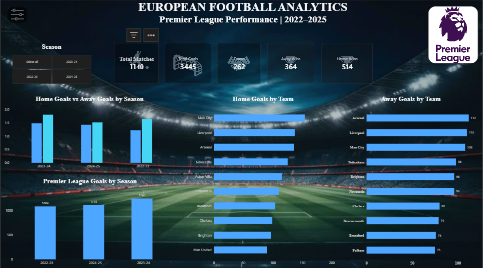
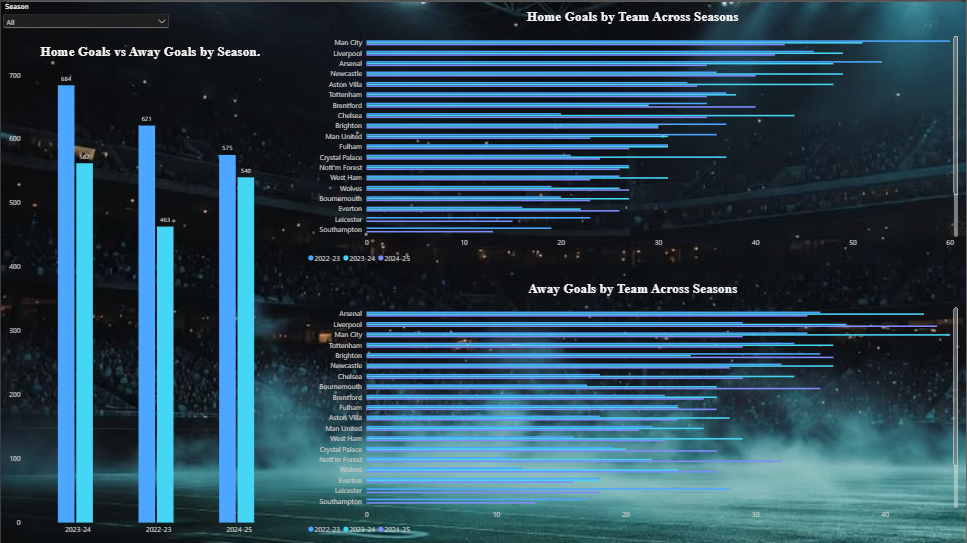
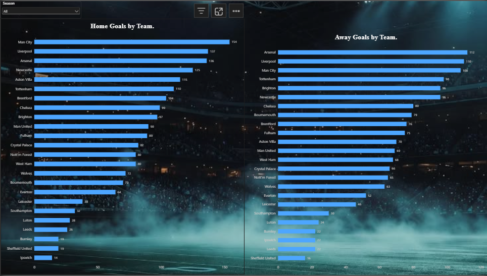
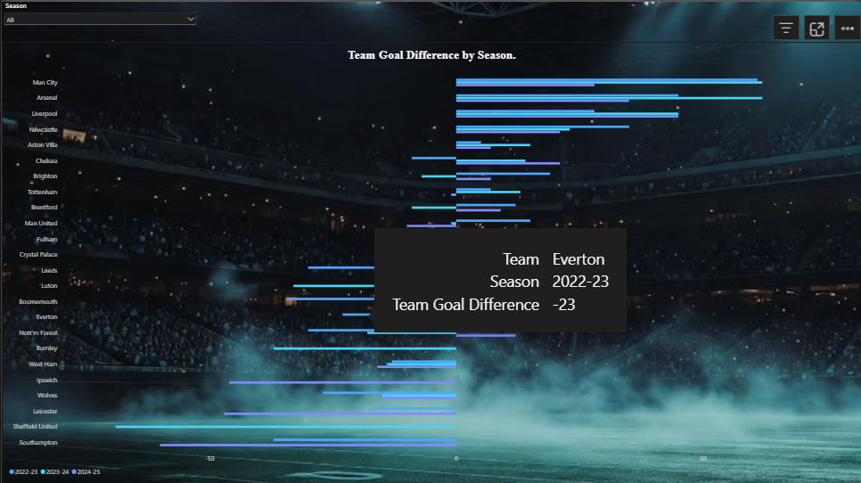

# European Football Analytics | Premier League Performance Dashboard (2022–2025)

## Project Overview

An interactive football analytics dashboard developed using Microsoft Power BI to analyse English Premier League performance across three seasons: 2022–23, 2023–24 and 2024–25.

The project explores team performance, attacking statistics, match outcomes and goal differences through interactive visualisations.

## Tools & Technologies

- Microsoft Power BI
- Power Query
- DAX (Data Analysis Expressions)
- Microsoft Excel

## Dataset

Source: [Football-Data.co.uk](https://www.football-data.co.uk/)

Competition: English Premier League

Seasons:
- 2022–23
- 2023–24
- 2024–25

## Dashboard Preview

### Key Performance Indicators
- Total Matches
- Total Goals
- Home Wins
- Away Wins
- Draws

### Goals Analysis

- Home Goals vs Away Goals by Season
- Premier League Goals by Season

- 
- Home Goals by Team
- Away Goals by Team

### Team Performance Analysis

- Team Goal Difference

- 
- Team Wins, Draws and Losses
- Team Win Percentage
- Season-based performance comparisons

## Key Findings

Across the three seasons included in the dashboard:

| Metric | Value |
|---|---:|
| Total Matches | 1,140 |
| Total Goals | 3,445 |
| Home Wins | 514 |
| Away Wins | 364 |
| Draws | 262 |

## Interactive Features

- Season slicer for comparing individual seasons.
- Interactive team performance analysis.
- Dynamic goal difference and match outcome comparisons.

## Project Files

- `European_Football_Analytics.pbix` – Power BI report.
- `Screenshots/` – Dashboard screenshots.

## Project Objective

The objective of this project is to demonstrate practical skills in data preparation, data modelling, DAX calculations, data visualisation and business-oriented analytical reporting through football statistics.

## Disclaimer

This project is an independent data analytics portfolio project. Football data is sourced from Football-Data.co.uk. Team and competition names are used for analytical identification.
